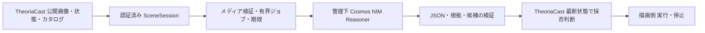

# Cosmos シーン観測 API v1 — AIKernel 実装・接続契約

更新: 2026-11-11。TheoriaCast の P0 要望に対するローカル開発版。
パッケージ: `AIKernel.Providers.Cosmos` **0.1.4-dev1** / .NET 10。
実装・オフライン試験と実機受入は別の段階です。実 Cosmos による B01〜B06 の受入は未完了です。

## 1. 配置と責任

この独立パッケージを AIKernel のホストへ任意登録します。`SceneSession` は正式な
`AIKernel.Abstractions.Capabilities.ICapabilityModuleInvoker` を実装します。
`CapabilityInvocationRequest/Result` は公式 Dtos パッケージの型を使用し、コピーしません。
既存 ChatOpenAIClient、会話 LLM、Bonsai LLM、AIKernel.BonsaiRules、Core、Control は変更しません。
AIKernel の既存プロバイダーからこの新パッケージへの依存も追加しません。

AIKernel は画像と許可カタログを検証して観測・候補を返します。TheoriaCast は画面取得、公開範囲の選別、
最新状態での採否判断、手動操作優先、音声同期、実行・停止を担当します。描画側の位置、衝突、到達可能性、
骨格・IK が正です。Cosmos には実行ツールも描画 API も与えません。`analysisOnly` は常に true です。
`FreshnessVerified` は時計・世代の検証結果だけであり、採用許可でも正解率でもありません。



TheoriaCast と同じ .NET ホストにこの SDK を置き、NIM だけ別 PC に配置できます。
メディア登録 API は `SceneSession.RegisterMediaAsync(registration, Stream, CancellationToken)` です。
別プロセスの AIKernel サーバーへ接続する場合は、ホスト既存の認証済み転送層で Stream と正式 Capability
envelope を運びます。この版には公開 HTTP アップロードサーバー/JWT 発行機能を含めません。
SDK に渡す `ClaimsPrincipal` はホストが検証したものに限ります。

## 2. 能力カタログと envelope

CapabilityId は **`vision.scene.reasoning`** です。すべての正常な応答 JSON は
`Metadata["scene.result_json"]` に入り、他の結果格納キーは作りません。

| Operation | Arguments | 結果 |
|---|---|---|
| `scene.capabilities` | 空辞書 | `SceneCapabilityCatalog`、上限・形式・直近 readiness。モデルは起動しない |
| `scene.analyze` | `request_json` のみ | `SceneAnalysisResult`。受付時点では queued/running の場合がある |
| `scene.status` | `requestId` のみ | 同じ認証主体の解析ジョブ照会 |
| `scene.cancel` | `requestId` のみ | 論理取消。バックエンド取消の結果は別フィールド |
| `scene.invalidate` | 空辞書 | `{ "status":"invalidated", "analysisOnly":true }`。当該呼出元の世代を失効 |

`scene.invalidate` 後は新しい sessionEpoch を使います。接続先や GPU を変更する操作は能力に含めません。
状態・カメラ・asset の変更を検知した TheoriaCast は直ちに invalidate するか、新しい観測を投入します。
AIKernel には未通知の描画変更を知る手段がないため、実行直前の検証は必須です。

`Succeeded=true` は API 処理の成功です。解析が failed/canceled でも照会成功なら true です。
不正入力・認可不成立・容量不足など受付拒否は `Succeeded=false` と `ErrorCode` を返し、推論しません。
`status=completed` は解析完了のみです。`performed` という実行結果は生成しません。
失敗の ErrorMessage は固定コードと同じ値です。モデル本文や例外詳細を流しません。
既存 ReplayLogHash は envelope でそのまま受け渡し、Cosmos 推論によるリプレイ一致を主張しません。

| 状態 | 意味 |
|---|---|
| accepted | 契約上予約。現実装の初回応答は queued/running/終端のいずれか |
| queued / running | 待機 / バックエンド処理中 |
| completed | JSON 検証済みの解析。空観測・空候補も成功 |
| canceled / timed_out | 呼出元取消 / 単調時計の処理期限超過 |
| superseded | 最新優先による待機置換、または場面・世代の失効 |
| failed | readiness、推論、応答検証などの失敗 |
| interrupted | 再起動時に完了を確定できなかったジョブ |
| rejected | 契約上予約。現実装では受付拒否を envelope の失敗で表す |

終端状態は後から成功へ変更しません。取得済みの結果を取り消す通信はないため、採用前の期限・世代検証は
TheoriaCast が行います。status 照会では古い結果の候補を空にした投影を返します。

全コードと呼出側の扱いは [COSMOS_SCENE_ERRORS.md](COSMOS_SCENE_ERRORS.md) を参照してください。

## 3. 正式型・JSON Schema・入力

正式型は `SceneContracts.cs`、`CosmosNimBackend.cs`。同梱 `schemas/` に要求・結果・モデル結果・能力カタログ・
メディア登録・メディア受領・配置証跡の **7 JSON Schema** と要求／結果の説明用 JSON を収録します。
説明用結果は `backend=example-only, isMock=true` であり、実推論証跡ではありません。
Schema は .NET の型から生成し、追加で enum、識別子、上限を制約します。JSON Schema だけでは表せない認可、
カタログの組合せ、版・時刻・blob の一致、JSON の重複キー、UTF-8 バイト数は実装側でも検査します。

```powershell
dotnet run --project tools/AIKernel.Cosmos.ContractExport -c Release -- src/Cosmos/AIKernel.Providers.Cosmos/schemas --check
```

JSON は UTF-8、camelCase、大小文字を区別します。未知フィールド・重複キー・非有限数を拒否します。
識別子は `[A-Za-z0-9][A-Za-z0-9_.:-]{0,127}`。長い台詞・RAG 本文・任意説明は受け取る型がありません。
`permissionScope` と `policyRevision` はホストの `ISceneAuthorizer` が返す grant と一致させます。
actorRevision、actionId、targetId も grant に存在し、候補の actor/action/target の組合せは要求カタログ内に限定します。
ホストは公開済みの対象だけを grant に含め、利用者ごとに認証主体を分離してください。

同一 snapshot は sessionEpoch、snapshotId、captureSource、capturedAtUtc、sceneRevision、layoutRevision、cameraId
が一致する必要があります。登録画像の frameId、寸法、MIME、offsetMs も再検査します。
assetRevision は actor ごとに grant と照合します。矛盾時は `inconsistent_snapshot` などで拒否します。
`program-composite` と `renderer-output` などの captureSource をホストで使い分けます。
字幕や合成後の重なりの評価には program-composite を渡してください。

capturedAtUtc は最後のフレームの UTC 時刻です。先行フレームは負の offsetMs、最後は 0。
frameId と mediaId はそれぞれ一意、offset は厳密昇順です。全フレームを同じ snapshot として登録します。
画像座標は **正規化 0〜1、左上原点、右が +x、下が +y、格納ピクセルの向き**です。
自由な 3D 座標、姿勢角、骨格座標を実行入力として返す型はありません。
facing/activity/speakerState は短い登録識別子であり、異なる空間の数値座標を混在させません。

初期メディアは非インターレース・8 bit RGB/RGBA PNG に限定します。シグネチャ、chunk CRC、IHDR 寸法、
展開した走査線の長さ・フィルター値を確認します。IHDR/IDAT/IEND と sRGB/gAMA 以外の chunk は拒否します。
EXIF、文字列メタデータ、ICC profile、palette/灰色 PNG、JPEG、動画コンテナは未対応です。
入力側で公開用 PNG を準備してください。サーバーは拒否画像を黙って変換しません。

blob はメモリ内の短期領域に保持します。登録時に原バイト列の SHA-256 と size を検査し、ランダムな mediaId を発行します。
所有者・scope・policy が異なる参照、期限切れ、任意 URL・UNC・ローカルパスを拒否します。
再起動後の blob は失われますが、既存 requestId の照会に画像の再送は不要です。
画像は通常ログ・監査 Metadata・ジョブ台帳に保存しません。返却 JSON だけを Metadata に入れます。

| 上限 | 既定値 |
|---|---:|
| 要求 / 検証済み結果 | 各 64 KiB |
| NIM 生応答 | 128 KiB |
| PNG 1枚 / 総メディア格納量 | 4 MiB / 64 MiB |
| 画像ピクセル数 | 2,073,600（幅×高さ） |
| フレーム / actor / 候補 | 8 / 64 / 16 |
| target / action / 観測結果 | 各 128 |
| NIM max_tokens | 2048 |
| 同時推論 全体 / 呼出元 | 1 / 1 |
| 同時メディア登録 | 2（満杯なら media_busy） |
| 呼出元の待機件数 | 1（最新優先） |
| ジョブ台帳総数（保持済みを含む） | 1000 |
| 最大観測年齢 / blob 有効期間 | 60秒 / 最大5分 |
| 冪等性保持期間 | 24時間 |

上限はホストの SceneOptions / CosmosNimOptions で設定し、さらにコンストラクターの絶対上限を適用します。
能力カタログが設定値の正です。17モデルは固定上限にしません。全体の待ち件数も台帳総数を超えません。

## 4. 観測・候補とハッシュ

観測の reasonCode は unknown / no_issue / attention_target_mismatch / target_not_visible / occlusion / overlap /
motion_observed / activity_mismatch / visual_anomaly。unknown=true と reasonCode=unknown は同時に指定します。
未知の actor を近似モデルへ割り当てません。不明な観測から候補は作れません。
motion_observed は異なる2フレーム以上の根拠が必要です。静止画から時間的継続を証明しません。
観測には frameId と必要に応じた領域を付け、候補は観測 ID を参照します。
候補 ID はサーバーが要求と候補から生成し、元の撮影期限を各候補にも付けます。
同じ snapshot に複数 actor の別候補を返せます。クライアントは epoch/requestId/proposalId で二重採用を防ぎます。
生の思考過程、confidence、任意スクリプト、シェル、MCP 操作、URL を出力するフィールドはありません。

この新契約のハッシュ形式は `sha256:<小文字64桁16進>` です。既存 ROM、StepId、ReplayLogHash は変更しません。

* InputHash: `Arguments["request_json"]` **その文字列の BOM なし UTF-8 全バイト**。空白、改行、プロパティ順も対象。
  `SceneProtocol.SerializeRequest` と `ComputeInputHash` を利用し、再送では同じ文字列を保持します。
  JSON を再整形すると同じ requestId でも競合する場合があります。JCS/NFC 正規化はしていません。
* contentHash: アップロードした PNG の**原バイト列**。モデルにはその検証済みバイトを送信します。
* OutputHash: `Metadata["scene.result_json"]` の BOM なし UTF-8 全バイト。照会時の失効投影は別の hash になります。
* proposalId: `scene-proposal.v1\n`、呼出元＋requestId の内部キー hash、InputHash、候補 index、候補の JSON を
  LF で結合した SHA-256 に `proposal-` を付けます。GPU 再推論の同一性を意味しません。

これらは整合確認であり、認可・署名・公開承認・採用許可の証明ではありません。

## 5. 非同期・期限・取消・再起動

InvokeAsync は検証・台帳書込みを ThreadPool に送り、推論を待たずジョブを返します。
呼出元の CancellationToken は受付処理の取消です。受付が確定したジョブの取消には requestId を使う
`scene.cancel` が必要です。受付応答を失った場合は同じ ID で照会／同一バイトの再送を行います。

撮影期限は `capturedAtUtc + maxObservationAgeMs` で固定し、結果返却時に延長しません。
ホストだけが SceneClockCalibration（serverUTC = callerUTC + Offset）を与えます。
較正期限内・不確かさ250ms以下のときのみ freshness を検証でき、未知なら観測だけを返し候補を空にします。
受信時に残り撮影期限と remainingBudgetMs の小さい方を単調時計へ変換します。
完了後も単調時計の撮影期限を維持し、壁時計を戻しても候補は復活しません。
将来撮影・期限切れを拒否します。再起動前の結果は再照会できても freshness を再保証しません。

待機枠が満杯なら古い queued を superseded とし、最新を待機させます。実行中の物理スロットは別に数えます。
scene.cancel/期限切れ/失効はバックエンドの RequestCancellationAsync に伝播します。
現在の NIM Chat Completions アダプターはジョブ取消確認 API を利用していないため `unsupported` を返します。
HTTP を切断して停止したことにせず、元の呼出しが終了するまでスロットを保持し、遅い結果は採用候補にしません。
将来のバックエンドが confirmed を返しても、AnalyzeAsync の終了まではスロットを解放しません。

NIM 接続断・transport timeout・不確実な 5xx/OOM では推論が残る可能性があるため、全体を degraded にし新規推論を停止します。
ホスト運用者が残存処理の終了を確認した後にだけ `ConfirmBackendQuiescent()` を実行します。
このメソッドは capability に公開していません。自動再起動・他モデル停止・勝手な別 GPU 移動は行いません。
初期ロードは別の運用過程で管理し、ready まで生成しません。probe timeout（既定5秒）と
推論 transport timeout（既定5分）は別です。短い probe 失敗でロードを再起動しません。

requestId の冪等性範囲は認証主体です。同一 ID・同一 InputHash は既存ジョブを返し、異なる入力は request_id_conflict。
台帳 jobs.json は最初の推論前に永続化します。単一 writer lock、同一ディレクトリ内 atomic replace を使用します。
未完了で再起動したジョブは interrupted となり、同じ ID から再推論しません。
取消後も物理処理が残る場合の印は永続化し、24時間の保持期限を過ぎても自動消去しません。
正常な終端記録は保持期間経過後に削除可能となり、その後の ID 再使用は新要求です。
消失・破損台帳から過去の exactly-once は証明できません。台帳を手動削除して復旧せず、停止確認と新しい epoch を運用で決めてください。
台帳書込み失敗は fail closed とし、新たな推論を止めます。ホスト側で専用アカウントの ACL とローカル耐久ストレージを管理します。

## 6. 接続・GPU・認証・障害復旧

CosmosNimBackend は実 HTTP の multimodal messages を送る実装です。content:string の既存チャット経路は再利用しません。
PNG は NIM 宛ての image_url/data URI としてのみ符号化し、ログや Metadata に base64 を出しません。
接続先はホスト設定の1つの root HTTPS URI、許可 IP 群で固定します。DNS 全回答を照合し、照合した IP へ接続します。
redirect/proxy/cookie を無効化します。169.254/16、link-local、multicast、unspecified は設定時にも拒否します。
管理下のプライベート IP は明示 pin で利用可能です。テスト用 literal loopback HTTP は明示設定時だけ許可します。
未知の endpoint へのリトライ・外部クラウドへの fallback はしません。

1. 運用者が隔離された推論環境、NIM image digest、モデル revision、精度、runtime version、GPU UUID を選びます。
   T1000 や描画 GPU に搭載可能とは仮定しません。モデルの小ささだけで Bonsai と共存可能とも判断しません。
2. `host-config.example.json` のプレースホルダーを実配置の固定値へ置き換えます。認証 token は secret store 経由で
   CosmosNimOptions.BearerToken に渡します。サンプルでは `AIKERNEL_COSMOS_TOKEN` を利用します。
3. 信頼する control plane が、実際のモデル、revision、精度、runtime、GPU UUID、image digest、観測時刻・有効期限を
   SceneDeploymentEvidence として提供します。ファイル版はホスト専用の配置証跡ファイルを読みます。
   **設定値をそのまま証跡として複写して「確認済み」にしないでください。** コンテナ実配置・GPU inventory・モデル artifact を照合します。
   証跡の有効期間は最大5分。期限切れ、配置違い、未知の状態なら ready にしません。証跡の読取りで配置変更はしません。
4. `SceneService` を Enabled=true で明示作成します。`ProbeAsync` は証跡、NIM `/v1/health/ready`、`/v1/metadata`、
   `/v1/models` を読むだけです。disabled/loading/warming_up/ready/busy/degraded/unavailable を区別します。
5. shadow で許可された画像だけを登録し、最新カタログを取得してから解析します。モデル名などを API 呼出側へ固定しません。
6. OOM/過負荷は backend_oom/backend_busy/backend_unavailable と再試行目安を返します。サーバーが構造化された OOM code を
   返さない場合は backend_unavailable とし、OOM と断定しません。再試行を自動連発せず、原因の確認後に新しい撮影を使います。
7. 無効化はこの optional service への新規投入を止め、scene.invalidate/cancel 後に DisposeAsync を await します。
   DisposeAsync は物理完了を待つため UI スレッドで同期 wait しません。NIM コンテナ停止は別の運用操作です。

画像・台詞全文・認証情報を通常ログへ書くコードはありません。ただしホストの HTTP tracing/APM が body を記録するなら
その設定を無効化してください。台帳には結果の短い観測コード、対象 ID、hash、状態が残ります。
評価画像保存はこの版では実装していません。必要な場合はホストが別の明示同意・期限・アクセス制御で収集します。
推定を人物記憶・漫画の正史へ書く API、RAG取得、作者資料参照はありません。

## 7. .NET 呼出し・互換性・配布

```powershell
# 外部通信しないサンプル: PNG登録、解析、照会、取消、期限切れ
dotnet run --project samples/Cosmos.SceneClient -c Release -- --offline-demo

# 運用者が承認した画像と管理下 endpoint を指定したときだけ利用
dotnet run --project samples/Cosmos.SceneClient -c Release -- --nim host-config.json approved-public.png
```

サンプルは runtime 起動・モデル切替・GPU 操作を行いません。--nim は指定画像を送信します。
本開発では --offline-demo だけを実行しました。サンプルの同一プロセス用時計較正を別 PC の時計に流用しないでください。

既存 `theoriacast.assistant.observer` / assistant.observe/report の実装へ変更を加えていません。
新 Capability は別の invoker 登録にルーティングし、既存の空 Arguments と theoriacast.result_json を維持してください。
このリポジトリには TheoriaCast 本体がないため、実際の AssistantObservationCapability との統合試験は未実施です。
独立 capability と公式型の検証、既存 Chat テストは自動試験で確認します。

新パッケージだけ 0.1.4-dev1。公式 Abstractions/Dtos/Enums は **[0.1.3-dev1]** に固定します。
パッケージ消費サンプルは Common/Core も [0.1.3-dev1] とし、既存5パッケージをアップグレードしません。
既存 public interface/DTO/enum を変更せず、新しい型は AIKernel.Providers.Cosmos 名前空間に追加します。
Scene v1 preview の破壊的変更は別 schemaVersion/パッケージ版とし、黙って意味を変更しません。

```powershell
dotnet pack src/Cosmos/AIKernel.Providers.Cosmos -c Release -o artifacts/cosmos-feed
# 承認された依存パッケージの取得先も含む NuGet.config を指定
dotnet restore samples/Cosmos.SceneClient -p:UseCosmosPackage=true --configfile <approved-NuGet.config> --force-evaluate
dotnet restore samples/Cosmos.SceneClient -p:UseCosmosPackage=true --configfile <approved-NuGet.config> --locked-mode
dotnet run --project samples/Cosmos.SceneClient -c Release -p:UseCosmosPackage=true --no-restore -- --offline-demo
```

既定の ProjectReference 用 packages.lock.json と、パッケージ消費用 package-consumer.lock.json を分けています。
TheoriaCast 側では新パッケージを追加して restore --force-evaluate を1度実行し、5パッケージが dev1 のままであることと
lock 差分をレビューしてから --locked-mode へ戻します。型のローカルコピーは作らないでください。
本パッケージはローカル nupkg で引渡し、NuGet 公開・push・PR は行いません。取得先と SHA-256 は検証報告を参照してください。

AIKernel ソースの既存ライセンスは Apache-2.0。新パッケージに NVIDIA 重み・NIM image・番組素材は含みません。
NVIDIA の現在の案内では Cosmos3 NIM コンテナは NVIDIA Software License Agreement と AI 製品条項、モデルは
OpenMDW-1.1 に分かれます。実際に選んだ image の LICENSE/MODEL_LICENSE/NOTICE を別途保存・確認してください。
現時点で実機のモデル・runtime・GPU は未選定／未測定です。SDK と契約の版固定を実機検証済みと読み替えないでください。

## 8. 対応表と未実装

| 要望 | この版の対応 | 残る条件・制限 |
|---|---|---|
| P0-1 | 独立 capability、実 HTTP multimodal Reasoner adapter、mock 明示 | 実 NIM の接続・モデル適合 B01 未検証。動画生成/action は範囲外 |
| P0-2 | PNG/時刻付きPNG列、状態、snapshot/版、blob所有者/hash/期限検証 | JPEG/動画未対応。別サービスのupload transportはホスト側 |
| P0-3 | strict JSON、観測/候補分離、複数actor、根拠、カタログ/版/サイズ検証 | 正しい視覚的判断は実機・人手評価が必要 |
| P0-4 | 非同期、有界最新優先、取消伝播、遅い結果破棄、永続冪等性、単調期限 | NIMの物理取消確認は非対応。多ホストactive-activeは非対応 |
| P0-5 | readonly readiness、配置証跡照合、IP/GPU固定、負荷上限、retry目安 | 起動/停止/配置は外部運用。実VRAM/競合測定は未実施 |
| P0-6 | 認証主体/grant照合、私的本文非要求、原画像非永続、固定接続先 | ホスト認証・ACL・公開範囲選別・APM設定は接続側で必要 |
| P1 時間的連続性 | 時刻付きPNG列、motion根拠2フレーム以上 | codec/fps・動画コンテナ未対応。定量評価未実施 |
| P1 複数演者 | ID/asset照合、未知保留、2actor自動試験 | 17モデルの識別・遮蔽評価は未実施 |
| P1 実行feedback | 未実装 | performed/rejected/canceled は TheoriaCast が正、観測で上書きしない |
| P1 短期状態 | epoch/版失効・冪等性・待機置換 | 推論上の反復抑制・カメラ往復抑制は未実装 |
| P1 mode | shadow/observe-only/propose | どの mode も SDK 自身は実行しない |
| P1 診断 | queue/preparation/inference/validation/入力年齢を結果に格納 | メディア転送の内訳、VRAM/CPU/p50/p95/p99集約は実機評価側 |
| P1 cache | 推論結果キャッシュなし | 冪等性照会のみ。期限延長なし |
| P2 | 未実装 | 多段階計画・録画品質レポート・モデル最適化は後続 |

## 9. 自動検証・実機評価

自動検証の具体的件数・全リポジトリ結果は `COSMOS_SCENE_VALIDATION.md` に記録します。
NimProtocolTests は HTTP handler を差し替えるプロトコル試験です。backend=cosmos の型を通ることは、
実 GPU で推論した証明ではありません。偽バックエンドの試験と実機 B01 を混同しません。

| 項目 | 自動検証の範囲 |
|---|---|
| A01 | 公式型、独立Capability、既存text試験。TheoriaCast実コンポーネントは未検証 |
| A02 | PNG＋状態、空結果、multimodal HTTP組立、時刻付き列 |
| A03 | 不正JSON/重複キー/未知フィールド/巨大結果/非有限数/未知ID/版違い、length/content_filter |
| A04 | 同一ID同時再送/競合、取消伝播、遅い返答、再起動、未完了物理処理の保持 |
| A05 | 古い/未来撮影、未知時計、期限切れ、時計巻戻し、epoch失効、policy変更 |
| A06 | 未認証、別主体blob、hash、CRC、期限、URL/UNC/path、禁止接続先 |
| A07 | 許可外の動作を返す敵対的モデル出力を拒否。画像中命令へのモデル自身の耐性はB02で評価 |
| A08 | unavailable/busy/不正応答、transport断の隔離。既存会話との性能共存はB05 |
| A09 | loading/warming_upの照会、別GPU証跡を拒否。配置変更操作なし |
| A10 | 台帳の原画像/本文非保存、analysisOnly、サニタイズされた失敗 |
| A11 | 2actorの別候補と安定ID。実行側の二重採用防止はTheoriaCastで検証 |
| A12 | 取消不能時の物理枠維持、待機置換、台帳容量上限 |

B01〜B06 は未実施です。接続先・モデル版・匿名化入力の使用許可が確定してから次の手順で共同検証します。

1. B01: image digest、モデルrevision/精度、GPU UUID、runtime、SDK/lock hash、prompt hash、匿名化入力と結果hashを保存。
2. B02: 同じ許可済み録画を状態のみルール、Cosmos shadow、observe-onlyで比較。2actorから開始し17モデルへ拡大。
   人手の正解表で視線/筆記/重なり/対象取り違え/誤検出/期限内に採用可能な割合を評価する。
3. B03: 入力枚数・解像度・同時負荷別に転送/待機/前処理/推論/検証、p50/p95/p99、失効率、取消、CPU/VRAMを測る。
   SDKの処理時刻だけを全体latencyとしない。timeoutや採用率を測定前に保証しない。
4. B04: TheoriaCast shadowから開始。期限内に有用性が確認された少数の視線・筆記動作だけ段階的に採用する。
5. B05: 両開発側で30分の会話入りローカル録画をbaselineと比較。Bonsai、記憶検索、妖精飛行、音声の実完了、
   Unity frame time p95/p99、OBS欠落、会話待ちを測定する。AIKernel単体試験で代替しない。
6. B06: Cosmosだけ無効化し既存動作が継続することを確認。YouTube送出・取引・現行配信の停止は行わない。

Doom は先行の汎用性検証先として、raw framebuffer と HUD 合成を別 captureSource にし、
観測だけの shadow を録画比較する計画です。Doomの入力操作へ接続する変更は今回含めません。
実機で期限に収まらない場合は採用を保留し、録画レビュー、入力削減、専用推論環境を比較します。

## 10. 参照した NVIDIA 公式資料

確認日 2026-11-11。latest は更新されるため、実導入では選んだ image の /openapi.json と版付き資料を証跡に固定してください。

* [API reference](https://docs.nvidia.com/nim/cosmos/latest/api-reference.html): Reasoner と Generator の経路・metadata の区別。
* [Reasoning](https://docs.nvidia.com/nim/cosmos/latest/reasoning.html): multimodal reasoning の入力。
* [Support matrix](https://docs.nvidia.com/nim/cosmos/latest/support-matrix.html): モデル/精度ごとのGPU・メモリ条件。
* [License and notices](https://docs.nvidia.com/nim/cosmos/latest/license.html): コンテナとモデルの配布条件の所在。
